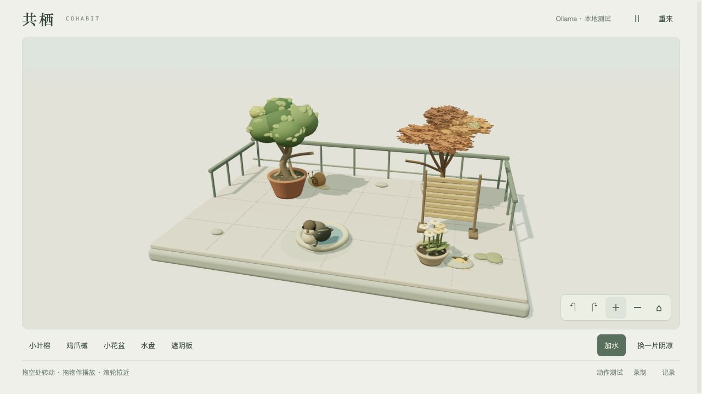

# Cohabitat / 共栖

A small 3D balcony where you rearrange the environment and watch four residents make their own choices. Two sparrows, a snail and a butterfly share water, shelter, flowers and space. Ficus and Japanese maple trees grow slowly under simplified water, light and space rules.

**Current build: local 3D prototype with real Ollama decisions. Nebius integration is implemented but not yet tested with a credential. This is not yet a completed hackathon submission.**



## Run

Requires Node 22+ and a WebGL2 browser.

```sh
npm ci --ignore-scripts
cp .env.example .env
npm start
```

Open `http://127.0.0.1:5321/`. The supplied development config selects a locally installed `qwen2.5:7b` model in Ollama. Start Ollama first. There is no automatic model download and cloud-tagged Ollama models are rejected to avoid unexpected paid use. An unreachable or missing model leaves the world manipulable but does not invent AI decisions.

For the competition connection, set `AI_PROVIDER=nebius` and `NEBIUS_API_KEY` in the server-only `.env` file. The default model is `nvidia/NVIDIA-Nemotron-3-Nano-30B-A3B`. Its availability is verified against the authenticated catalog. Never put a key in browser code or Git.

## Play

- Drag empty space to orbit; scroll to zoom. The lower-right camera buttons are keyboard-accessible.
- Drag a pot, water dish or shade screen. Invalid overlaps retain the most recent valid position.
- Add water, or select a plant and water it. Move the screen to change local shelter.
- Alternatively select an object using the controls, focus the canvas and use arrow keys; Shift moves faster, Escape deselects, Space pauses.
- The resident actions are the response. There is no chat, hidden-thought transcript, friendship score or guaranteed happy relationship.
- A browser tab saves its own v2 world locally. Hidden or closed tabs stop simulated time and requests. Legacy v1 storage is left alone.

`/?mode=motion` is a **clearly labelled hand-authored movement test**, not AI. `/?debug=1` exposes performance exports and a repeatable 175-second intervention test. Recording captures the real canvas with its provider/test label. Click the recording button again to stop and save early.

## Boundaries

`world.mjs` owns world coordinates, candidate actions, grounded paths, occupancy, perception, event memory and growth. `art.mjs` owns Three.js meshes, animation and orbit/raycast controls. `app.mjs` connects input, simulation, persistence, recording and decisions. `server.mjs` validates requests and connects Ollama or Nebius. `budget.mjs` keeps a persistent server ledger.

The model selects up to three candidate IDs. It does not output geometry, run JavaScript, move the camera or directly write memories. Only actual arrivals, completed drinking/feeding/sheltering and observed neighbor events enter the 12-event memory. Actions are rechecked against the current scene and target occupancy before execution. A moved target causes a mechanical safety transition from the current position; it is recorded separately from a model decision.

Perception uses distances and conservative canopy/pot/screen geometry. Tree foliage is decorative geometry within those shared canopy envelopes; this is an artistic simulation, not botanical or light-transport science. Growth is one small new branch/leaf cluster per tree; occupied main branches stay fixed. No promise of unlimited growth or biologically accurate behavior.

Ollama is serialized to one local request; Nebius allows one in-flight request per resident. A session allows at most 12 calls/minute. Public-server global limits and the 100-CNY ceiling apply as well. Provider, model, action, request duration and execution outcome are recorded separately. Private logs and credentials are not served as static files.

## Verify

```sh
npm test
```

One executable assertion check covers 3D targets, occupancy, illegal/stale actions, continuous safety transitions, actual shared-space memories, isolation of private resident memories, snail paths, v2 persistence, budget restart behavior and HTTP boundaries. It does not make inference calls.

Pause the residents and run `node verify-model.mjs` to replay two fixed observations from real play. This makes 18 real calls through the selected provider: three repetitions with actual memory, empty memory, and empty memory plus unobserved neighbors. Candidates stay identical; none of these plans are executed or remembered. Optional arguments select the case file and output file. Repeated-input timings benefit from inference caching and are not live latency.

The compact input supplies distances and grouped actual encounters instead of redundant coordinate JSON. Satisfied animals cannot repeatedly consume; short, clear ground approaches use hops, and safety landings no longer add an idle five-second hold. These are world/animation rules, not evidence of model intelligence. The final prompt's two fixed comparisons still found **no reliable effect of memory on the selected action**. An intermediate prompt showed a difference but also let an urgent snail wander without shelter; that is not accepted as a successful relationship mechanism.

See [the latest optimization measurements](evidence/optimization-1/VERIFICATION.md) and [the original ten-minute baseline](evidence/3d/VERIFICATION.md). Model response targets are p50 ≤3 seconds and p95 ≤5 seconds. Browser targets are approximately 60fps and software input feedback <100ms; these are measured separately from model latency. Local tests cannot establish production host performance or Nebius latency.

## Deployment and license

[The deployment runbook](deploy/README.md) describes the dedicated Node service and `/cohabitat/` Nginx route. The public host, real Nebius calls and English submission video still require verification before submission. The app performs no purchases.

Code and procedural models are MIT licensed. Three.js is MIT licensed. [Credits](CREDITS.md) document dependencies and the separately retained historical pixel baseline.
